# BillboardOS

**The operating system for autonomous outdoor advertising.**

BillboardOS is a Cal Hacks 13.0 hackathon project: a network of AI-assisted digital billboards that understand local audience activity, price available ad slots, match advertisers, negotiate proposals, handle payments, schedule creatives and reconcile delivery.

> **Status:** Design + documentation scaffold. Source material and proposed features are clearly differentiated. Implementation and sponsor integrations are not yet built.

## Documentation hub

**[Open the documentation index](docs/index.md)** · [Coinbase x402 research](docs/competition/coinbase-x402-research.html) · [Competition guide](docs/competition/index.md) · [All sponsor tracks](docs/competition/sponsor-tracks.md) · [Original guide: extracted text](docs/competition/official-guide-text.md) · [Product vision](docs/product/vision.md) · [System architecture](docs/architecture/overview.md) · [MVP roadmap](docs/development/roadmap.md)

| Focus | Documentation |
|---|---|
| Original hackathon rules | [Event guide summary](docs/competition/index.md) · [extracted source text](docs/competition/official-guide-text.md) |
| All sponsor tracks & prize references | [Sponsor catalog](docs/competition/sponsor-tracks.md) |
| Target sponsors and eligibility plan | [Track strategy](docs/competition/track-strategy.md) |
| Coinbase x402 implementation plan | [Research brief and demo blueprint](docs/competition/coinbase-x402-research.html) |
| Original project brainstorm | [Ideation](docs/notes/ideation.md) · [original text](references/original/pasted.txt) |
| Product requirements | [Vision](docs/product/vision.md) · [MVP acceptance tests](docs/product/requirements.md) |
| Engineering | [Overview](docs/architecture/overview.md) · [Agents](docs/architecture/agents.md) · [Payments & risk](docs/architecture/payments-and-risk.md) · [Data model](docs/architecture/data-model.md) |
| Team execution | [Setup](docs/development/getting-started.md) · [Roadmap](docs/development/roadmap.md) · [Demo](docs/demo/judging.md) |

## How it works

```mermaid
flowchart LR
    Buyer[Advertiser or buyer agent] --> Brief[Campaign brief]
    Brief --> Match[Inventory + audience matching]
    Match --> Quote[Pricing + negotiation]
    Quote --> Hold[Exclusive slot hold]
    Hold --> Verify[x402 payment verification]
    Verify --> Book[Booking + creative approval]
    Book --> Display[Physical billboard]
    Display --> Audit[Playback and revenue audit]
```



## Development

```bash
git clone https://github.com/PhongCT1105/BillboardOS.git
cd BillboardOS

# Optional docs website (MkDocs Material)
python -m venv .venv
source .venv/bin/activate
pip install -r requirements-docs.txt
mkdocs serve
```

We are using GitHub Markdown + optional MkDocs Material so the docs work immediately in the repo and can later be published as a docs site.

## Key sponsor ambitions

- **Hyphenate** — auditable, bounded autonomous finance operations and recovery from booking/payment exceptions.
- **Coinbase x402** — compatible machine payment for a protected ad-booking endpoint.
- **CRS** — meaningful sandbox verification/risk review, only if available APIs fit.
- **CREAO** — an autonomous, one-operator billboard company.
- **Microsoft / Convex / Visa** — production-minded agents, reactive shared state and commerce experience, as applicable.

Sponsorship-track eligibility requires actual adherence to each sponsor's rules and proof during the demo. We do **not** claim existing integrations.

## Provenance and privacy

Official competition text extracted from the uploaded Cal Hacks guide is provided for reference; the unmodified PDF should be retained separately and consulted for full rules. Team brainstorm text is tracked in `references/original/`. Uploaded images and the ~17-minute recording have **not been committed or transcribed**. Do not publish team audio without permission.

See [source register](docs/competition/sources.md).
