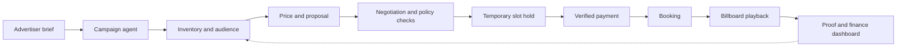

# BillboardOS documentation hub

**BillboardOS** is a proposed autonomous operating system for digital out-of-home (DOOH) advertising: camera/sensor-based audience estimates, inventory-aware dynamic pricing, agent-mediated advertiser sales, machine payments, slot scheduling, and auditable finance operations.

> **Stage:** Planning / Cal Hacks 13.0 MVP. Descriptions of capabilities are design intentions, not claims of implemented software.

## Start here

| If you're… | Read |
|---|---|
| Checking official competition rules | [Competition guide](competition/index.md), [all sponsor tracks](competition/sponsor-tracks.md) |
| Deciding what to enter | [Track strategy](competition/track-strategy.md) |
| Building for Coinbase x402 | [Research brief and BillboardOS payment blueprint](competition/coinbase-x402-research.html) |
| New to the idea | [Vision](product/vision.md), [original ideation](notes/ideation.md) |
| Building the MVP | [Requirements](product/requirements.md), [architecture](architecture/overview.md), [roadmap](development/roadmap.md) |
| Building agents or finance | [Agent protocol](architecture/agents.md), [payment and risk](architecture/payments-and-risk.md) |
| Preparing judging | [Live demo](demo/judging.md) |

## End-to-end business loop

## Sources, not guesses

- **Official:** The uploaded *Cal Hacks 13.0 Hacker Guide*, particularly printed pages 7–19 (rules and sponsor tracks) and 23–24 (hardware), remains the primary event source. See [source register](competition/sources.md).
- **Original brainstorm:** User-provided `pasted.txt`, two annotated JPEGs, and an audio recording. The written concept is condensed in [ideation](notes/ideation.md). The audio has **not been transcribed**; its content is not assumed.
- **Our designs:** Architecture, financial state machine, API shapes, priorities and sponsor strategy are proposals awaiting team decisions.

For development, treat **official rules**, **confirmed product requirements**, and **optional integrations** as different categories. Avoid portraying a mock flow as a live sponsor integration.
